# Rebuttal

**Live demo: [rebuttal.sjapathway.workers.dev](https://rebuttal.sjapathway.workers.dev)**

An AI agent that defends merchants against PayPal payment disputes. It reads each dispute's reason code, works out which evidence would answer it, pulls that evidence from the transaction record, drafts the seller response in the structure PayPal accepts, and tells the merchant honestly whether the case is worth fighting, settling or conceding. Nothing is sent to PayPal without the merchant's approval.

No account is needed to try it: the console opens on a demo workspace of 40 seeded disputes, and a PayPal sandbox workspace runs the same agent on real sandbox disputes.

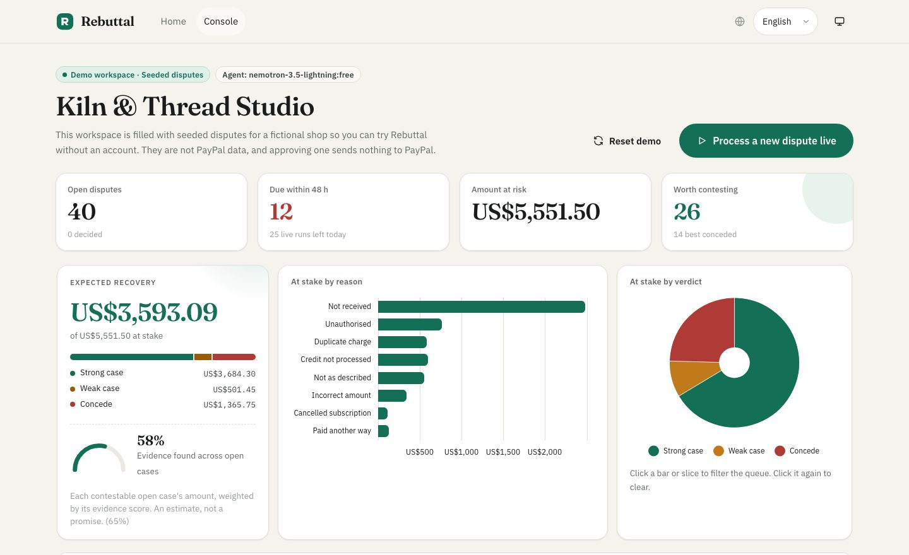

## The problem

A small merchant gets a dispute notification with a deadline, often only days away. To contest it they have to find the transaction, the delivery proof, the messages and the refund policy, then write a rebuttal in the format the payment processor accepts. Most merchants can't do that in time, so they lose by default and absorb the loss. Some of those disputes were winnable. Others were never worth fighting, and contesting them just wastes the merchant's time.

Rebuttal is for small and mid-sized online merchants who sell through PayPal and don't have a disputes team.

## What it does

1. **Watches the queue.** Lists open disputes and orders them by response deadline.
2. **Works out what has to be proven.** Every reason code has its own evidence playbook. An "item not received" dispute needs tracking, a delivery scan and an address match. An "unauthorised" dispute needs address and security-code checks, device history and earlier undisputed orders.
3. **Gathers evidence from the record.** Order details, amounts, dates, fulfilment and shipment data, buyer messages, refunds, policy, and the buyer's history with this merchant.
4. **Drafts the response** in PayPal's `provide-evidence` structure (`evidence_type`, `tracking_info`, `refund_ids`, notes under 2,000 characters), citing only evidence it found. The case file's **PayPal request** tab shows the exact request body that will be filed, built by the same function the worker sends.
5. **Fact-checks the draft.** Every amount, date and identifier in the draft must appear in the dispute or transaction record. If one doesn't, the draft is rejected and the agent has to fix it.
6. **Scores the case**: strong, weak or concede. When the merchant's own records work against them (the parcel was returned to sender, or the buyer cancelled before the charge), Rebuttal recommends accepting the claim and says why.
7. **Offers a third path: settle.** For weak and concede cases it proposes a partial refund sized by the evidence score, about the merchant's expected loss if they fight. The merchant can adjust it and send it through PayPal's `make-offer` endpoint, so the dispute ends for less than a full refund.
8. **Waits for the merchant.** They review, edit, approve, settle or accept the claim, one at a time or in bulk.
9. **Shows where the money is.** An expected-recovery forecast, cross-filter charts, and a full AG Studio analytics workspace with its own AI agents.

## AI in Rebuttal

AI runs through the product, not just behind one button. Every model call goes through OpenRouter from the Worker, so no key reaches the browser.

### The dispute agent

A tool-calling loop, not a single prompt behind a form. The model plans, calls tools, reads the results and decides what to do next:

| Tool | What it returns |
| --- | --- |
| `list_disputes()` | Open disputes and deadlines |
| `get_dispute(id)` | Reason code, amount, stage, deadline, buyer's claim |
| `get_transaction(id)` | Items, amounts, fulfilment, shipment, messages, refunds, policy, risk checks |
| `search_transactions(buyer_email)` | The buyer's other transactions with this merchant |
| `assess_evidence(dispute_id)` | Each required item as found, partial, missing or contradicts, plus score and verdict |
| `draft_response(dispute_id, notes, cites)` | Accepts the draft only if every cited item was found and the fact check passes |

Every step is logged with its reasoning, arguments, output and timing, and shown in the case file's **Agent log** tab. **Process a new dispute live** streams the agent working a fresh case. Real disputes synced from the PayPal sandbox are worked by the model. If the model is unavailable, the run finishes with a deterministic rules engine, and the UI says which engine produced each case.

### The assistant

An **Ask Rebuttal** assistant sits on every page and streams its answers. On the landing page it explains the product. In the console it sees the visitor's queue, plus the full case file of any dispute they mention, so it can answer "which disputes should I handle first?" or "why is PP-D-100081 strong?". Dispute IDs in its answers open that case in the grid.

It can also **act**. Ask it to "approve every strong case due in the next 48 hours" and it turns the request into a filter (`verdict = strong`, `due ≤ 48 h`). The app applies that filter to the live queue, so the model never picks disputes by itself, and shows the matching disputes on a card. Nothing happens until the merchant presses **Confirm**. Every case file also has an **Ask AI about this case** button.

### AG Studio agents

The **Analytics** view is an [AG Studio](https://www.ag-grid.com/studio/) workspace driven by the **Studio Agent Framework**:

- Studio's five built-in agents (lead, planning, data, page, widget) run on OpenRouter through a server-side proxy in the OpenAI Responses format. All five are briefed on Rebuttal's data model.
- **Dispute analyst** is Rebuttal's own agent. It sits alongside the built-in team, and the lead delegates to it. It has two custom tools: `get_case_file`, which reads the verdict, evidence statuses, gaps and draft, and `open_case_in_queue`. Ask "why did PP-D-100081 get its verdict?" and the lead hands off to it, which reads the case file and reports the exact score and evidence.
- Ask the agents for a widget ("add a donut of money at stake by reason, for open disputes only") and the lead delegates to the page and widget agents, which place and configure it on the dashboard.

## AG Grid

### The dispute queue (AG Grid Community)

The queue uses only **AG Grid Community** and **AG Charts Community**, both MIT licensed, so it needs no licence key. Features that usually need Enterprise are built from Community building blocks:

- **Cross-filter charts** (AG Charts): amount at stake by reason (bars) and by verdict (donut). Clicking a bar or slice writes the grid's column filter. Filtering a column from its header highlights the charts in turn, and each chart is drawn from the rows the other one leaves in.
- **Expandable case files** as full-width rows: each opens the full case file (evidence, editable response, PayPal request, settlement, agent log, order record) right under its dispute. The row sizes itself to its content and stays attached through sorting, filtering and quick search.
- **Grouping by reason or verdict** with cell spanning: one merged cell per group, showing its count and total.
- **Checkbox filters** for reason, verdict, status and stage. They're written as AG Grid filter handlers, so a chart click filters the grid even before the panel is opened.
- Column groups and custom cell renderers: deadline countdown bars, verdict and status pills, a score bar with evidence dots, reason glyphs, and seeded/sandbox origin tags.
- Multi-row selection with bulk approve and bulk concede, CSV export, a live footer, and AG Grid's locale packs for Arabic, French and Spanish.
- A command palette (<kbd>⌘K</kbd> / <kbd>Ctrl K</kbd>) and <kbd>/</kbd> for quick search.
- One theme built from the app's design tokens, so the grid re-tints for light and dark mode and mirrors for right-to-left.

### Dispute analytics (AG Studio)

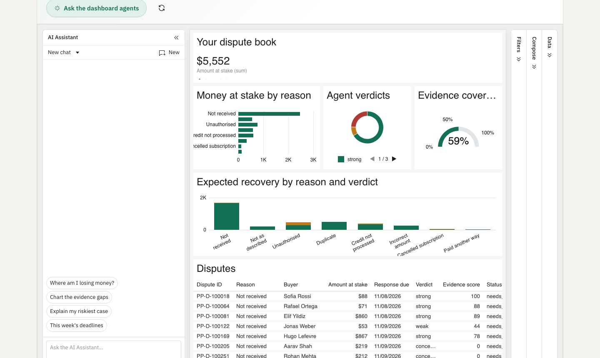

- **Three ready-made pages** over two related tables (disputes, and one row per evidence check):
  - **Overview:** money at stake, expected recovery, verdict mix, an evidence coverage gauge, and recovery by reason and verdict.
  - **Evidence gaps:** which requirements the record most often lacks, with a pivot by reason.
  - **Deadlines:** a day-by-day due chart and a soonest-first table.
- **Deadline radar**, a custom widget: open disputes plotted on rings at 24 hours, 48 hours and 7 days to their deadline, coloured by verdict and sized by amount. It reads through Studio's data engine, so page filters and cross-filters apply. Clicking a dot opens the case in the queue. It is registered in Studio's Compose menu under "Rebuttal", with AI metadata so the agents can add it too.
- **Themed** with Studio's theming API to match Rebuttal: brand chart palette, IBM Plex Sans, and separate light and dark modes that follow the app's theme toggle.
- Everything stays editable, by hand or by the agents.

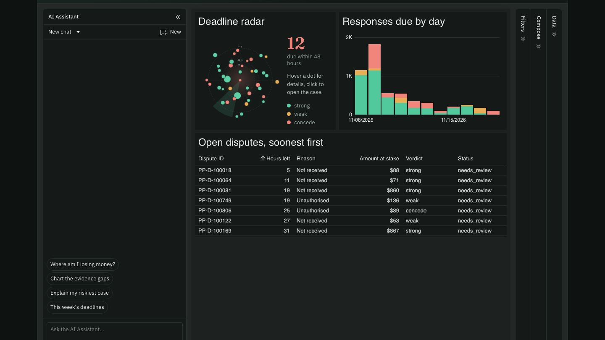

## PayPal

### Demo workspace

Each visitor gets their own workspace of 40 seeded disputes for a fictional shop, spread across eight reason codes and the strong, weak and concede outcomes. Every seeded record is labelled `seeded` in the UI. None of it is PayPal data, and approving a seeded response sends nothing anywhere.

### PayPal sandbox workspace

When sandbox credentials are configured, a **PayPal sandbox** workspace appears next to the demo.

- **Syncing:** it pulls real disputes from the sandbox Disputes API, including the buyer's own description. It looks up the underlying transaction in the Transaction Search API, and falls back to the Payments, Orders and Tracking APIs when Transaction Search isn't enabled or hasn't indexed a new payment yet.
- **Filing:** approved responses go to PayPal through `provide-evidence`, concessions through `accept-claim`, and settlements through `make-offer`.
- **Sandbox only:** the client is hard-wired to `api-m.sandbox.paypal.com`, so live credentials can't be used.

Verified end to end with dispute `PP-R-LKW-10197052`:

1. A sandbox order was created, captured and given a tracking number.
2. The sandbox buyer opened an "item not received" dispute.
3. Rebuttal synced it and the AI agent worked it: it found the tracking number but no delivery scan. Its verdict was concede (25/100), with a drafted recommendation, and the fact check passed.

To create your own test dispute:

1. Run `npm run sandbox:order` and approve the order with your sandbox personal (buyer) account.
2. Open the payment at sandbox.paypal.com as that buyer, choose **Report a problem**, and submit.
3. Click **Sync from PayPal** in the console.

## Guardrails

- **Never invents evidence.** Drafts are built from found evidence only, and the fact check rejects any value not in the record. Missing evidence is shown to the merchant, never implied to PayPal.
- **Never acts alone.** Every filing, concession, settlement and bulk action waits for the merchant's confirmation, including actions the assistant proposes.
- **Grounded AI answers.** The assistant and the Studio agents answer from the workspace data and case files they are given, and say when something isn't covered.
- **Not legal advice.** Rebuttal organises the merchant's own records and says so in the product.
- **Sandbox only.** No live PayPal credentials anywhere.

## Setup

Requires Node 20 or later.

```bash
git clone https://github.com/sja-thedude/Rebuttal.git
cd Rebuttal
npm install
cp .env.example .dev.vars   # fill in sandbox values (all optional for the demo)
npm run dev                 # http://localhost:5173
```

The demo workspace works with no environment variables at all. Without a model key, agent runs use the rules engine and the assistant is unavailable.

Two variables belong in other files:
- `VITE_AG_STUDIO_LICENSE_KEY` is read at build time from `.env.local`. AG Studio runs locally without it, but shows a watermark.
- `OPENROUTER_MODEL` and `OPENROUTER_STUDIO_MODEL` are set in `wrangler.jsonc` vars.

Other scripts:

```bash
npm run agent                 # run the agent over all seeded disputes in the terminal
npm run agent -- PP-D-100081  # full reasoning log and draft for one dispute
npm run gate                  # one real call to the PayPal sandbox Disputes API
npm run sandbox:order         # create a real sandbox order to open a test dispute on
npm run build                 # typecheck and build
npm run deploy                # build and deploy to Cloudflare Workers
```

### Environment variables

Names only; see `.env.example`. Set Worker secrets with `wrangler secret put <NAME>`.

| Name | Where | Purpose |
| --- | --- | --- |
| `PAYPAL_CLIENT_ID` | Worker secret / `.dev.vars` | PayPal **sandbox** REST app client ID |
| `PAYPAL_CLIENT_SECRET` | Worker secret / `.dev.vars` | PayPal **sandbox** REST app secret |
| `OPENROUTER_API_KEY` | Worker secret / `.dev.vars` | Model access through OpenRouter |
| `OPENROUTER_MODEL` | `wrangler.jsonc` vars | Models for the dispute agent and assistant, a comma-separated list tried in order |
| `OPENROUTER_STUDIO_MODEL` | `wrangler.jsonc` vars | Models for the AG Studio agents |
| `VITE_AG_STUDIO_LICENSE_KEY` | `.env.local` (build time) | AG Studio licence key |

## Stack

- **Frontend:** React 19 and Vite, with hand-written CSS design tokens. Fraunces, IBM Plex Sans, IBM Plex Sans Arabic and IBM Plex Mono.
- **Grid and charts:** AG Grid Community 36.3 and AG Charts Community 14.3 for the queue; AG Studio 3.1 with the Studio Agent Framework for analytics. AG Studio is loaded only when the Analytics view opens.
- **Backend:** Cloudflare Workers, with a Durable Object per demo workspace (SQLite-backed storage) and one shared sandbox workspace. Agent runs, assistant answers and Studio agent turns stream to the browser over server-sent events.
- **Languages and themes:** English, Arabic (right to left), French and Spanish. Light and dark themes that follow the system setting, with a toggle.

## Tools

| Tool | How it's used |
| --- | --- |
| **PayPal Disputes API** (sandbox) | List and show disputes; `provide-evidence`, `accept-claim` and `make-offer` |
| **PayPal Transaction Search API** (sandbox) | Find the disputed transaction and the buyer's other transactions |
| **PayPal Orders, Payments and Tracking APIs** (sandbox) | Create test orders, capture them, attach tracking, and read order details when Transaction Search has nothing yet |
| **PayPal OAuth 2.0** (sandbox) | Client-credentials token for the calls above |
| **OpenRouter**, `nvidia/nemotron-3.5-lightning:free` with `openai/gpt-oss-120b` as fallback | The dispute agent's tool loop and the assistant. The free model goes first; OpenRouter falls back to the low-cost model when the free pool is busy. Each case file records which model answered. |
| **OpenRouter**, `openai/gpt-oss-120b` with the free model as fallback | The AG Studio agents, whose larger tool schemas need a stronger model; called in the OpenAI Responses format |
| **AG Grid Community** and **AG Charts Community** | The dispute queue and its cross-filter charts (MIT, no licence key) |
| **AG Studio** and the **Studio Agent Framework** | Analytics dashboards, built-in agents plus a custom dispute analyst, and the Deadline radar custom widget (trial licence) |
| **Cloudflare Workers and Durable Objects** | Hosting, API, per-workspace state and usage limits |
| **Playwright** | Product screenshots and the Open Graph image (development only) |

## Screenshots

| | |
| --- | --- |
| 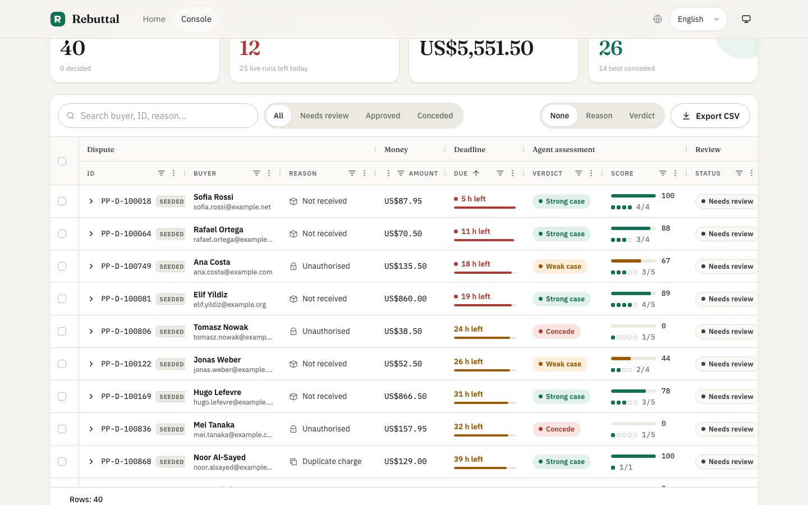 | 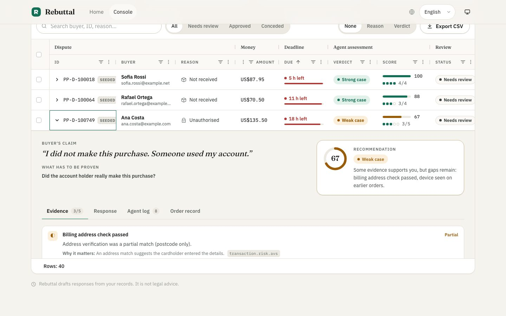 |
| 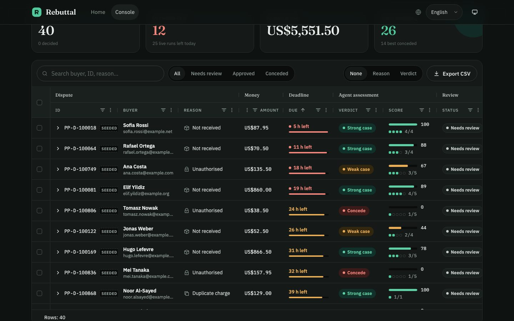 | 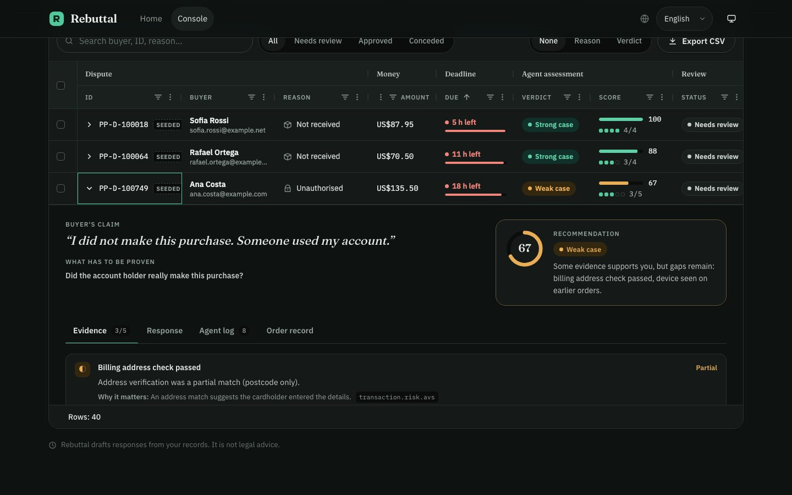 |
| 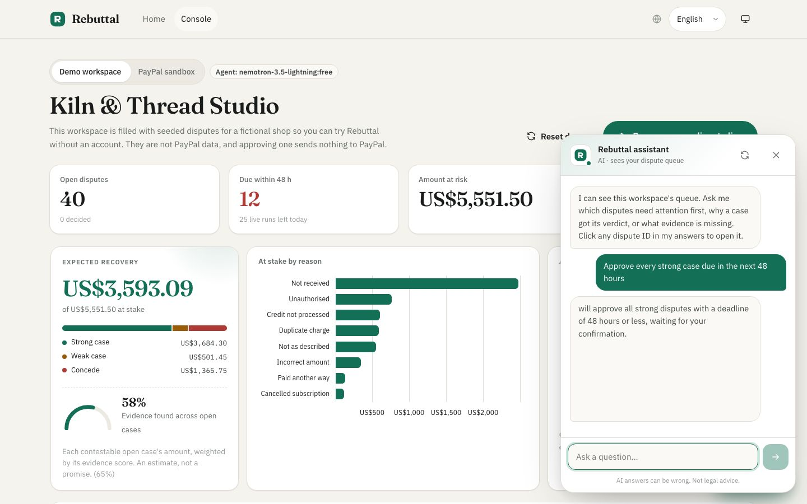 | 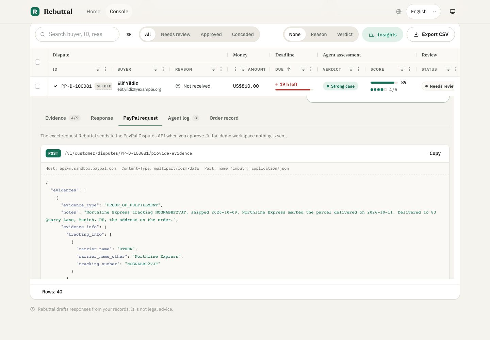 |
| 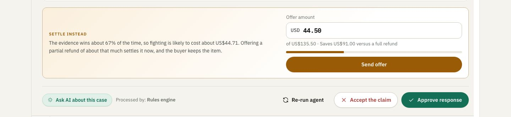 | 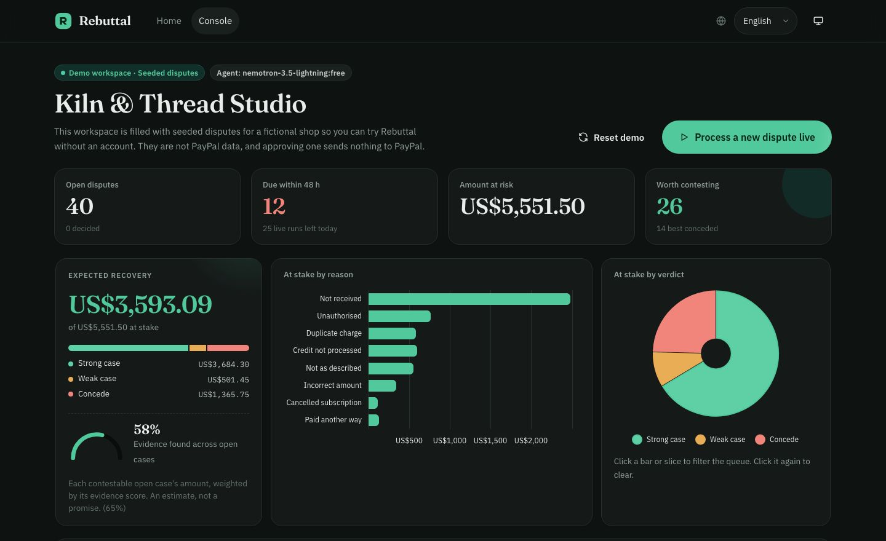 |

## Hackathon categories

Submitted to the PayPal AI Hackathon, targeting **Most Impactful**, **Best Use of PayPal + AI**, **Best Use of Agentic Commerce** and **Best Use of AG Grid**.

## Licence

MIT. See [LICENSE](LICENSE).
